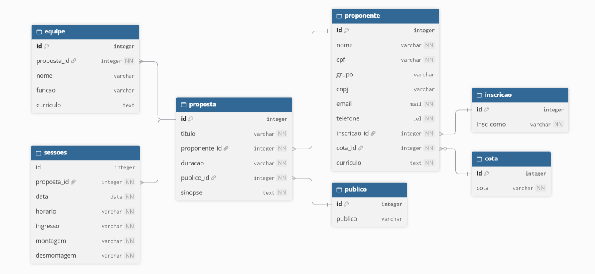

## Sobre o projeto
 
Este repositório reúne o **Trabalho de Conclusão Anual (TCA)** de **Pedro Dias de Souza**, aluno do **Instituto Federal — Campus Rio Grande**.
 
O projeto é a base para um futuro **TCC**: o **site oficial do Teatro Municipal de Rio Grande**. O objetivo é **modernizar** a presença digital do teatro e **preservar** a história desse espaço, tão importante para a região em diversos aspectos: cultural, artístico, histórico e social.
 
---

## Objetivos
 
- Criar um canal oficial e moderno de comunicação do Teatro Municipal
- Divulgar notícias e as peças em cartaz a cada mês
- Facilitar a solicitação de ocupação do teatro para eventos
- Preservar a memória cultural do município por meio de um museu online colaborativo
- Envolver a comunidade na construção e na validação dessa memória
---
 
## Diagrama do sistema

 

 
## Páginas do site
 
O site é composto por **4 páginas**:
 
### Página Inicial
Porta de entrada do site e vitrine do teatro.
- Apresentação do Teatro Municipal
- Espaço reservado para **notícias** (implementação futura)
- Destaque para as **peças em cartaz no mês**
- Navegação para as demais páginas
### Formulário de Ocupação de Eventos
Página para solicitar o uso do teatro.
- Formulário **baseado nos editais oficiais dos últimos anos**
- Campos para dados do proponente, tipo de evento, datas e necessidades técnicas
- Objetivo: padronizar e agilizar o pedido de ocupação do espaço
### Museu Online
Um museu virtual para guardar e contar as histórias de Rio Grande.
- Acervo de **fotos antigas**
- Histórias de **antigos pontos culturais** do município
- Registro de **grupos culturais locais**
- **Seção de comentários** aberta a qualquer pessoa que tenha informações, fotos ou memórias para compartilhar
- Informações **comprovadas** podem ser **agregadas ao acervo do museu**
### Gerenciamento de Comentários (CRUD)
Página administrativa ligada ao museu online.
- **C**reate: cadastrar comentários/informações
- **R**ead: listar e visualizar os comentários enviados
- **U**pdate: editar ou corrigir comentários
- **D**elete: remover comentários inadequados ou inválidos
- Apoia a **verificação** das informações antes de entrarem no museu
---
 
## Próximos passos (TCC)
 
- Sistema de notícias na página inicial
- Agenda de peças em cartaz atualizada pelo teatro
- Moderação e aprovação de conteúdos do museu
- Integração com a administração do teatro
---

## Autor
 
**Pedro Dias de Souza**
Instituto Federal — Campus Rio Grande
 
---
 

*Preservando as histórias de Rio Grande*
 

